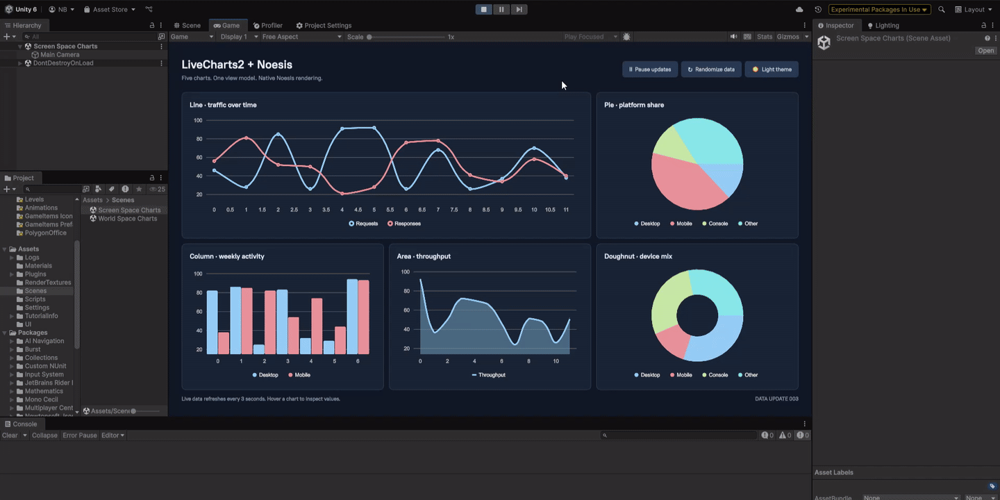
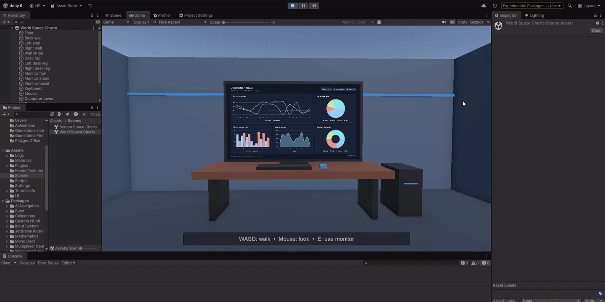

# LiveCharts2 for Noesis in Unity

Five animated charts in a shared MVVM dashboard: line, column, area, pie and doughnut. Includes dark/light themes, automatic updates, pause/resume and a randomize command.

## Screen space

## World space

## Setup

1. Download the NoesisGUI 4.0.1 Unity package from [Noesis](https://www.noesisengine.com/developers/downloads.php).
2. Before opening Unity, create `LocalPackages` in the project root and place the archive at `LocalPackages/NoesisGUI-Unity-4.0.1-Indie.tgz`.
3. Open the project with Unity **6.1+**. Unity installs the local package automatically from the reference in `Packages/manifest.json`.
4. Open `Assets/Scenes/Screen Space Charts.unity` or `Assets/Scenes/World Space Charts.unity` and press Play.

The archive filename must match the manifest entry. If yours differs, rename it or update the `com.noesis.noesisgui` path in the manifest. You can also install it through Package Manager using **Add package from tarball**.

The Noesis SDK and license settings are excluded from this repository. LiveCharts2 and its .NET dependencies are included under their respective licenses. This example uses the direct Noesis renderer, without SkiaSharp.

## Platform testing

These results cover the Unity demo and the LiveCharts2 Noesis port it uses. The confirmed builds were made with **Unity 6.1**.

✅ Tested and working · ❓ Not tested yet · ❌ Tested and not working

| Platform / backend | Status |
| --- | --- |
| Windows / Mono | ✅ Working |
| Windows / IL2CPP | ✅ Working |
| macOS / Mono | ✅ Working |
| macOS / IL2CPP | ✅ Working |
| Linux / Mono | ✅ Working |
| Linux / IL2CPP | ✅ Working |
| Android | ✅ Working |
| iOS / iPadOS | ❓ Not tested |
| tvOS | ❓ Not tested |
| WebGL | ❓ Not tested |
| UWP | ✅ Working |
| Xbox Series X&#124;S | ✅ Working |
| Xbox One | ❓ Not tested |
| PlayStation 4 | ❓ Not tested |
| PlayStation 5 | ❓ Not tested |
| Nintendo Switch | ❓ Not tested |
| Nintendo Switch 2 | ❓ Not tested |

Can you help test a platform or backend? Please [open an issue](https://github.com/nadjibus/UnityNoesisLiveCharts2/issues/new) with your results, Unity and Noesis versions, scripting backend, device/OS and graphics API. Try both scenes, animations, randomize/pause, theme switching and monitor input; include logs or screenshots if something fails.

## Scenes

- **Screen Space Charts**: the dashboard fills the game view.
- **World Space Charts**: a computer monitor displays the same dashboard through a render texture. WASD moves, the mouse looks around, and E enters monitor interaction and Escape returns to walking. The mouse cursor is hidden while walking. Click the monitor controls while interacting.

`DashboardViewModel` owns the series, observable values, commands and theme state. `DashboardHost` binds it to Noesis and applies the palette. The controller handles only movement and interaction mode. Data refreshes every three seconds; transitions animate through LiveCharts2.

## Rebuilding the chart libraries

The included chart DLLs are built from the Noesis port in [nadjibus/LiveCharts2](https://github.com/nadjibus/LiveCharts2/tree/nadjibus/noesis-dotnet). With that checkout alongside this project, run `Tools/Build-Charts.ps1` after Unity has compiled the Noesis package. Pass `-SourceRoot` for another checkout location.
